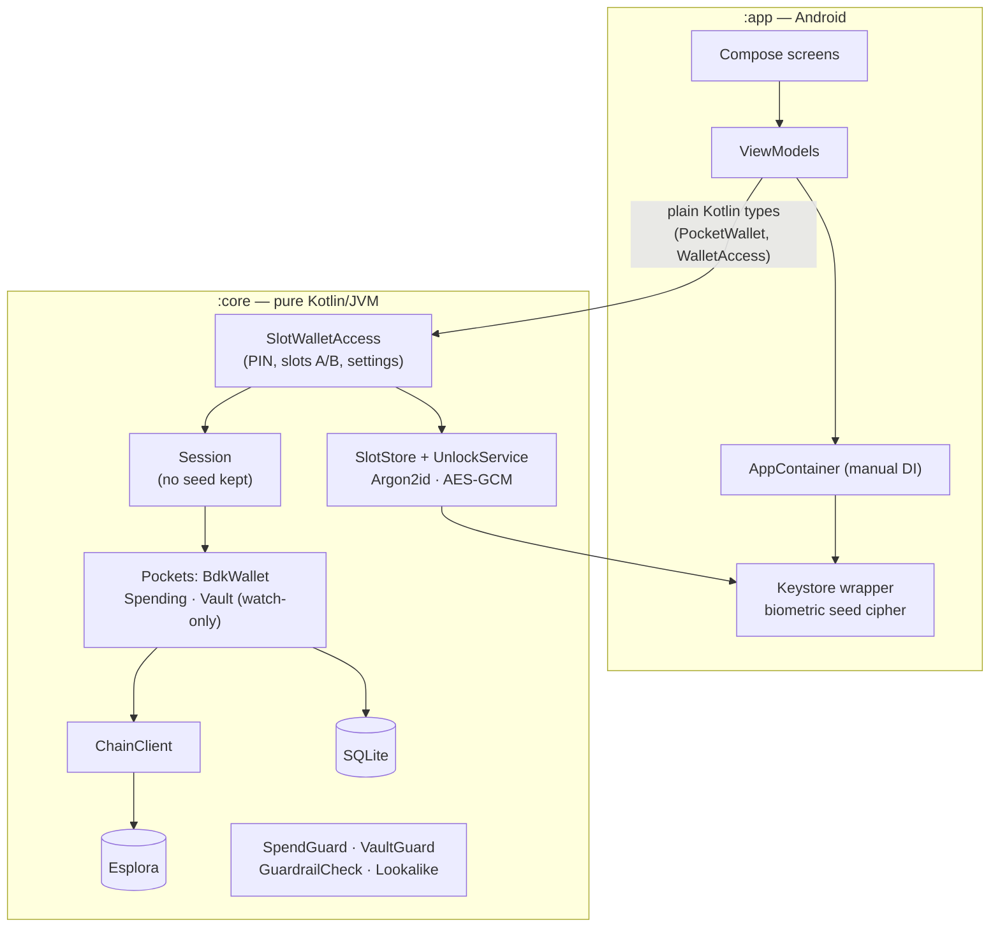

# BitPocket

[](https://github.com/brunogutierre/BitPocket/actions/workflows/ci.yml)

A layered-security Bitcoin wallet for Android, built as a study project.

> [!WARNING]
> **Study project — runs on Signet/Testnet4 only; mainnet is disabled by design; not audited.**
> Never use it with real funds.

## Goals

- Explore how an Android wallet can protect users in layers: key storage, spending limits,
  coercion resistance, inheritance and privacy.
- Keep the architecture simple, modern and explicit, with every decision documented.

## Features

| Area | What it does |
|---|---|
| **Storage** | The seed lives only in an encrypted slot file: Argon2id(PIN) + AES-GCM, wrapped by an Android Keystore key (StrongBox when available). Unlock tries both slots in constant time, with growing lockouts. |
| **Spending pocket** | BIP86 Taproot wallet, watch-only in SQLite, synced with Esplora. Receive (QR, BIP21), send (fee speeds, send all, coin choice), history with labels. |
| **Signing** | The session never keeps the seed: each signature asks for a Class 3 biometric (BiometricPrompt + Keystore) or the PIN. The signed transaction must match what was reviewed. |
| **Safety UX** | Address fingerprint (3 words + identicon), guardrails (per-transaction and 24-hour limits that loosen only after 144 blocks, confirmations for new recipients and large amounts), look-alike address warning, paste only on tap, QR scanner. |
| **Vault** | A second pocket, `wsh(or_d(multi(2,PHONE,RECOVERY),and_v(v:pkh(HEIR),older(N))))`: every spend needs the phone plus 12 offline recovery words. Encrypted backup that any cosigner can open. |
| **Inheritance** | Heartbeat warnings before the heir timelock expires, refresh by a 2-of-2 self-transfer, and an heir claim flow that needs only the backup file and the heir's words. |
| **Duress** | A second PIN opens a real decoy wallet; nothing in the app reveals which one is open. |
| **Privacy** | Custom Esplora server (https, genesis-checked), coin control (freeze, hand-pick), BIP329 label import/export. |
| **Security check** | A score (A–F) of the setup, with a link to fix each missing item. |
| **Auto-lock** | Locks after a chosen time in the background; the recents card is blank. |

## Tech stack

| Area          | Choice                                              |
|---------------|-----------------------------------------------------|
| Language      | Kotlin 2.4 (AGP built-in Kotlin), JVM target 17     |
| UI            | Jetpack Compose + Material 3, Navigation 3          |
| Build         | Gradle 9.8 (Kotlin DSL, version catalog), AGP 9.4   |
| Android       | minSdk 30, target/compile SDK 37                    |
| Bitcoin       | BDK 3.1.0 (`bdk-android` in `:app`, `bdk-jvm` for tests) |
| Chain backend | Esplora (mempool.space Signet/Testnet4, or your own) |
| Crypto        | BouncyCastle Argon2id, JCA AES-GCM and HKDF, Android Keystore, androidx.biometric |
| QR            | zxing `core` (encode/decode), CameraX (`camera-compose`) |
| Tests         | JUnit 6 (Jupiter), coroutines-test, Turbine, Kover (>= 80% line coverage) |
| Networks      | Signet (default) and Testnet4 only                  |

## Architecture



- `:core` holds every rule that can run on the JVM and is tested there with the real BDK
  (`bdk-jvm`); `:app` only adds Android: UI, Keystore, biometrics, camera and wiring.
- View models never see BDK types: ports use plain Kotlin types (`txid:vout`, base64 PSBTs).
- Secrets live only in the encrypted slots and, during one signature, in memory. Wallet databases
  are watch-only.

## Decisions

| Decision | Why | Record |
|---|---|---|
| BDK as `compileOnly` in `:core`, `bdk-jvm` in all unit tests | Fast JVM tests against the real Rust code | [ADR 0001](docs/adr/0001-bdk-on-jvm-for-core-tests.md) |
| Vault policy with explicit branch and pre-broadcast guards | BDK pitfalls found in the M0 spike | [ADR 0002](docs/adr/0002-vault-policy-and-signing.md) |
| Mainnet impossible by types, CI and tests | Unaudited study wallet | [ADR 0003](docs/adr/0003-mainnet-disabled.md) |
| Watch-only wallets, short-lived signers, no seed in the session | Keys never persisted by BDK; a biometric gate means nothing if the seed stays in RAM | [ADR 0004](docs/adr/0004-watch-only-wallets-and-esplora-sync.md) |
| Security settings in the encrypted slot, changed only after the PIN | Authenticated, per wallet (real or decoy) | [ADR 0005](docs/adr/0005-security-settings-in-the-slot.md) |
| Guardrails: tighten now, loosen after 144 blocks | Someone holding the unlocked phone cannot raise a limit and spend at once | [ADR 0006](docs/adr/0006-guardrails-anchored-to-block-height.md) |
| Vault keys at BIP48, heir in the policy from day one, backup any cosigner can open | No address migration later; no extra password to lose | [ADR 0007](docs/adr/0007-vault-keys-setup-and-backup.md) |
| Heartbeat shown in the app; refresh = 2-of-2 self-transfer; heir claim without a wallet | No background access to the encrypted wallet; the heir needs only the backup and their words | [ADR 0008](docs/adr/0008-heartbeat-and-heir-claim.md) |
| Duress PIN opens a decoy in slot B; the app never knows the slot | Coercion resistance without a PIN oracle; CI guards the slot boundary | [ADR 0009](docs/adr/0009-duress-pin-and-decoy-wallet.md) |
| Custom Esplora server only, https + genesis check | One backend to maintain; refuses other networks | [ADR 0010](docs/adr/0010-custom-server-esplora-only.md) |
| Frozen coins = BDK locked outpoints; labels = one BIP329 JSONL file per wallet | No extra database; the storage format is the export format | [ADR 0011](docs/adr/0011-coin-control-and-labels-storage.md) |
| SpendGuard on every spend: confirmed coins only | Unconfirmed `older()` spends abort the process in BDK 3.1.0 | [ADR 0002](docs/adr/0002-vault-policy-and-signing.md) |
| Manual DI (`AppContainer`) | A few dozen classes do not need a framework | — |
| QR with zxing `core` and CameraX; uppercase BIP21 | Open source, no Play Services, JVM-tested; alphanumeric mode makes smaller codes | — |
| Address fingerprint: 3 BIP39 words + mirrored identicon from SHA-256 | About 57 bits a human can compare by eye or voice; frozen by a test vector | — |
| Look-alike warning always on; paste only on tap; copied address cleared after 60 s | Address poisoning and clipboard hijacking target what people compare and copy | — |
| At most 10 unused receive addresses | A restore scans until 20 unused in a row (stop gap) | — |
| Amounts in whole sats, minimum 546 | No decimal separator to get wrong; above every dust limit | — |
| Fee estimates fetched directly (any 2xx) | mempool.space answers `/fee-estimates` with HTTP 203, which BDK's client rejects | — |
| `androidx.biometric` 1.1.0 stable + `FragmentActivity` | No alpha libraries on the signing path | — |
| R8 keeps JNA and the BDK bindings | Both are used by reflection and from native code; neither AAR ships rules | — |

## Threat model

| Threat | What BitPocket does |
|---|---|
| Stolen locked phone | Seed encrypted under Argon2id(PIN) and a device-bound Keystore key; lockouts that survive restarts and clock changes; no screenshots of words; blank recents card. |
| Thief or coercer with the unlocked phone | Each signature needs biometrics or the PIN again; spending limits that loosen only after 144 blocks; the Vault needs offline recovery words; a duress PIN opens a decoy. |
| Swapped or look-alike addresses | Address fingerprint on Receive and Review, look-alike warning, QR scanning, paste only on tap. |
| Losing the phone | Restore from the 12 words; import the Vault backup; the heir can claim after the timelock. |
| Chain backend surveillance | Your own Esplora server (https, network-checked), coin control and labels kept on the device. |
| **Out of scope** | Device forensics (two wallet directories exist once a decoy is used), a malicious or compromised OS, a lying Esplora server (no header verification), and any use on mainnet. |

## Try it on Signet

1. Install the debug APK (CI artifact, or `./gradlew assembleDebug`). Create a wallet: write and check the
   12 words, choose a PIN.
2. Receive: get Signet coins from a faucet (search "signet faucet") to the shown address; pull to refresh.
3. Send a little back to the faucet's return address; Review shows the fingerprint, fee and total.
4. Settings: turn on fingerprint signing, set a spending limit, a duress PIN and auto-lock.
5. Vault: Settings → Set up the Vault with the **1 hour** waiting time; Move to Vault; once confirmed,
   send from the Vault (recovery words + PIN). After 6 blocks, "Claim an inheritance" (on another
   phone or after erasing) sweeps the Vault with the heir words and the backup file.
6. Security check on Home shows the grade and what is missing.

## Building and testing

Requirements: JDK 17+ and the Android SDK (platform 37). Point Gradle to the SDK with
`local.properties` (`sdk.dir=/path/to/Android/Sdk`) or `ANDROID_HOME`.

```bash
./gradlew spotlessApply                      # format Kotlin sources (ktlint); run on its own
./gradlew :core:test testDebugUnitTest lint  # unit tests (real BDK on the JVM) and lint
./gradlew koverVerify koverHtmlReport        # coverage gate (>= 80% lines)
./gradlew :core:test -Plive                  # opt-in tests against public Signet servers (not in CI)
./gradlew assembleDebug                      # debug APK
./gradlew assembleRelease                    # R8 release build (unsigned)
adb install app/build/outputs/apk/debug/app-debug.apk
```

- Run `spotlessApply` in its own Gradle invocation: with the configuration cache, Gradle may run it in
  parallel with compilation and rewrite sources mid-compile.
- CI (GitHub Actions) runs the mainnet and slot guards (`scripts/check-no-mainnet.sh`,
  `scripts/check-no-slot-in-app.sh`), then `spotlessCheck lint :core:test testDebugUnitTest koverVerify assembleDebug`,
  on every pull request and push to `main`.
- Instrumented tests (`app/src/androidTest`) cover the Keystore and the Argon2 benchmark on a device.

## Roadmap

- [x] M0 — Bootstrap: build, CI, coverage, `:core` module and BDK de-risking spikes
- [x] M1 — Spending wallet: encrypted storage, PIN, onboarding, sync, receive, send with biometrics, history, auto-lock
- [x] M2 — Safety UX: address fingerprint, guardrails, clipboard/poisoning warnings
- [x] M3 — Vault: miniscript 2-of-2 with offline recovery key, encrypted descriptor backup
- [x] M4 — Inheritance: heir timelock path and heartbeat refresh
- [x] M5 — Duress PIN and decoy wallet
- [x] M6 — Privacy: custom server, coin control, BIP329 labels
- [x] M7 — Security health score and final documentation

Possible next steps: PSBT export to an offline signer for the recovery key, header verification
(compact block filters) instead of trusting Esplora, and a dependency refresh (BDK 3.1.1 is out:
re-check the ADR 0002 upstream issues first).

## License

[MIT](LICENSE) © 2026 Bruno Gutierre
